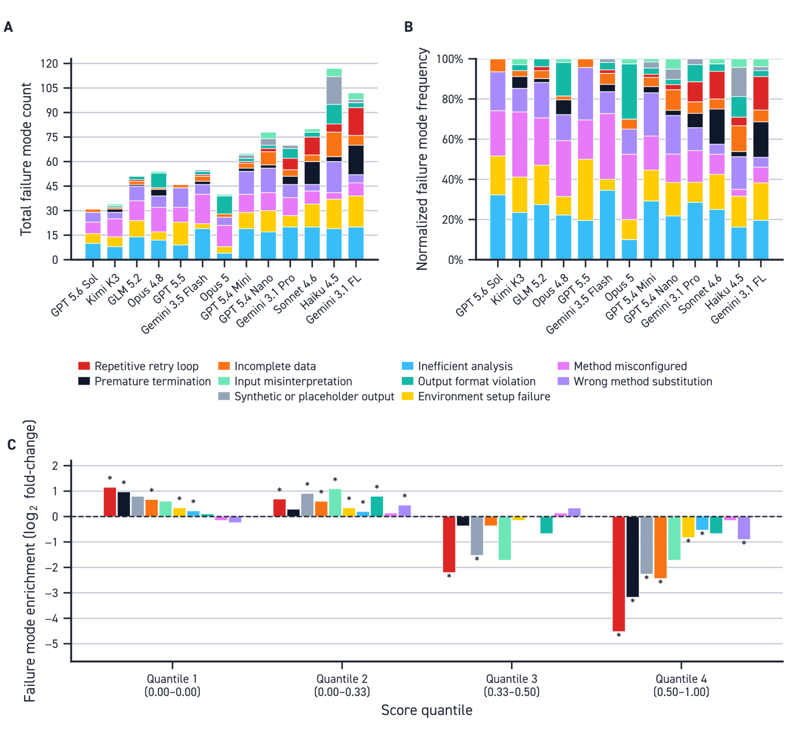
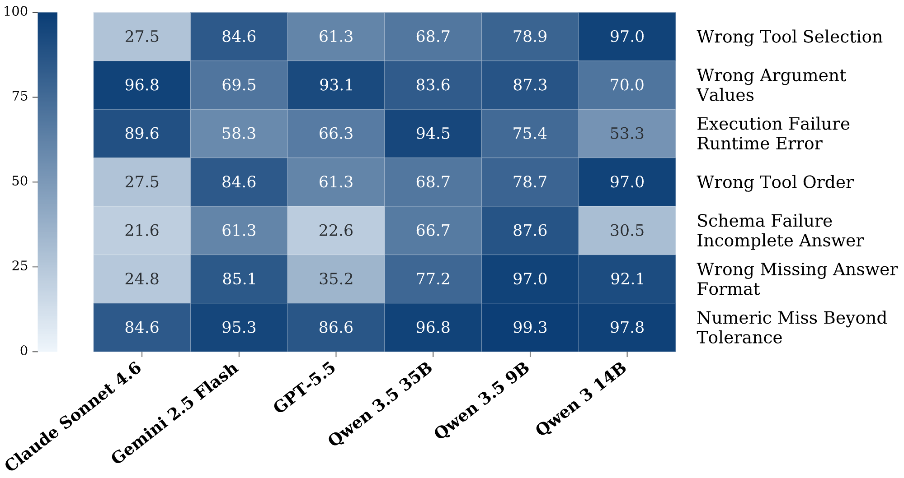

100% of the founders and engineers I know in startups are working on or in AI, full time. Full stop. We use it up and down the stack. Emails, accounting, product, design, coding, security, dev-ops, research, and everything in between. Stepping outside the community, talking with a lot of old collaborators and friends, it's clear that diffusion into domains I care most about is slow. Who's building with and in AI for the planet, full time? Conservation and machine learning have gone hand in hand for years (camera traps, satellite alerts, niche modeling). Yet, among the people doing the work to protect our planet, the proportion using general-purpose AI full time is much smaller than I would have guessed.

From conversations with old collaborators and colleagues so far, I think the gap between startups and conservation comes down to three things:

1. Time and money. AI companies can often throw thousands of dollars toward tokens to solve one problem (<https://gdpx.semianalysis.com>). That only happens after spending real time learning how to ask the right questions, validate the output, and steer the runs so you get a high hit rate. I bet some of this is the trap of grant funding with budgets written a year or more ago: those budgets never planned for frontier models as powerful as those they could be using today.
2. Social alignment. In startups, you're getting behind if you aren't getting ahead on AI. Because of that, for startups most of the conversation at events, in hiring, in planning has moved to trying to understand how to maximize the leverage of AI and figuring out what happens to a company when you can hand entire workflows over to agents.
3.  Model fitness. SOTA models in 2026 have been trained heavily on the problems where there is a verifiable outcome. E.g., coding, math, algorithms, etc. Wei's asymmetry of verification and verifier's rule (<https://www.jasonwei.net/blog/asymmetry-of-verification-and-verifiers-law>) and Karpathy's verifiability (<https://karpathy.bearblog.dev/verifiability/>) make this point clearly.

I'm digging into the third bucket because I suspect the challenge of getting AI to do high quality science holds up the first two. It slows the social conversation and leads many conservation practitioners to feel that their work can't be securely outsourced to AI. In ecology, for example, a study can run cleanly, give a number and still answer the wrong question (without unit tests to easily verify against). The problem pervades the scientific process.

I measured the failure modes of AI in aiding scientific research across research I've done the past months and [compiled a list of common challenges](https://gist.github.com/andrewxhill/0da6c5383b11eb542a385508a6bc42c8) the AI had that limited its ability to succeed. Many of these have been found after wasting significant tokens on AI building the wrong thing. The recurring problem was that AI could build a convincing study while drifting from the original question, making unfair comparisons or claiming more than the experiment measured.

This is a problem in scientific research. In coding, AI appears much better at self correction. Paired with a body of public tooling (claude skills, libraries, harnesses, etc), even vibe coders often get sufficiently good results to outsource entire code building jobs to AI. My guess is that training on code taught models how to work toward a functioning end result. As long as they stay on one of the many paths that get them there, they succeed. Conservation doesn't have an easy way to verify that end state, so when an AI gets lost, it just stops and calls it done anyway. This has been found by others too (<https://arxiv.org/abs/2607.27191>, <https://arxiv.org/abs/2608.24979>, <https://arxiv.org/abs/2607.01507>, <https://arxiv.org/abs/2609.28850>). In coding, tests run in seconds and cost nothing. In conservation, it's often years between observation and understanding.

Unfortunately, conservation isn't a field that most AI Labs are focused on. SemiAnalysis argues that the first trillion dollars in AI revenue will go to a few sectors where frontier models will have the highest ROI (<https://newsletter.semianalysis.com/p/gdpx-measuring-frontier-model-capabilities>). That doesn't mean conservation is necessarily going to be left behind.

The biology that labs are going to pay for is drug discovery, disease, medicine and food. But still, winning in those fields will mean that the models and harnesses may get better at what a field ecologist needs too (especially if they learn to avoid the pitfalls seen in research planning and execution). The progress looks exciting, too. Much of it needs systematic tests and benchmarks focused on conservation work:

- **Google DeepMind's Co-Scientist** tackled made-up results, a failure my own trials kept hitting. Checking every number against its code cut them from 54% to 22% (<https://arxiv.org/abs/2608.26701>).
- **Sakana's Agentic Scientist** focuses on fair comparisons, building its own baselines and ablations (<https://arxiv.org/abs/2610.18933>).
- **Shanghai Jiao Tong University's Xcientist** keeps every claim tied directly to its evidence (<https://arxiv.org/abs/2606.18874>).
- **Anthropic's Claude Science** catches bad citations, untraceable numbers, and figures that don't match their code (<https://www.anthropic.com/news/claude-science-ai-workbench>).
- **Ai2's AstaBench** measures science agents fairly, across more than 2,400 problems with controls for cost and tools (<https://arxiv.org/abs/2510.21652>).
- **Google's Earth AI agent** takes on open-ended geospatial problems that break models with basic tools (<https://research.google/pubs/google-earth-ai-geospatial-reasoning-agent-capabilities-and-a-systematic-evaluation/>).
- **Google DeepMind's OCELOT** maps where species live, including places nobody has surveyed. Trained on about 2 billion GBIF records across 100,000 taxa, it ranks the likely species in held-out regions 51% better than a model given coordinates alone (<https://arxiv.org/abs/2611.00284>).
- **Google's empirical software system** pushed remote-sensing segmentation forward, beating the best published scores (<https://arxiv.org/abs/2509.06503>).

What's missing is measurement. Most ecology benchmarks I found test what models know, not whether they can run a study. Two come closer. BixBench3 gives agents the raw data from 20 published biology studies and scores what they produce. The best of 13 current models scores 0.48 out of 1, and the failures that mark the worst runs include stopping early, swapping in a method the task didn't allow, and writing placeholder numbers (<https://arxiv.org/abs/2608.25286>). TerraBench gives agents 403 tasks on satellite, climate and GIS data. Even the best model's numeric answers miss the allowed error 84.6% of the time (<https://arxiv.org/abs/2606.13148>). Neither scores an agent on the work conservation teams do: setting up a study of mangrove recovery after a storm, tuning a classifier to find invasive species in camera-trap photos, filling in the days a stream gauge missed to flag when a river drops below its legal minimum flow, or modeling coastal currents to trace where sewage from a storm overflow goes and whether it reaches the beach where people surf.

<figure>
  
  <figcaption class="caption text-muted">Failure modes by model on BixBench3. The two lowest-scoring models collect 102 to 117 failure tags, against 31 to 51 for the top three. Koch et al. 2026, Figure 5, CC BY-SA 4.0. <a href="https://arxiv.org/html/2608.25286v2#S2.F5">Source figure</a>.</figcaption>
</figure>

<figure>
  
  <figcaption class="caption text-muted">Dominant failures on TerraBench&#x27;s earth-system tasks. Numeric answers outside the allowed error are the most common failure for four of the six models. Nguyen et al. 2026, Figure 8b, CC BY 4.0. <a href="https://arxiv.org/html/2606.13148v2#S5.F8">Source figure</a>.</figcaption>
</figure>

<table class="table table-condensed" style="font-size: 14px;">
  <thead>
    <tr>
      <th scope="col">Benchmark</th>
      <th scope="col">Deployed tools</th>
      <th scope="col">EO imagery</th>
      <th scope="col">Env. data</th>
      <th scope="col">GIS ops</th>
      <th scope="col">Simulator tasks</th>
      <th scope="col">Numeric eval.</th>
      <th scope="col">Real-world</th>
      <th scope="col">Hybrid annot.</th>
    </tr>
  </thead>
  <tbody>
    <tr>
      <th scope="row">ThinkGeo (2025)</th>
      <td>✓</td>
      <td>✓</td>
      <td>✗</td>
      <td>△</td>
      <td>✗</td>
      <td>✗</td>
      <td>✓</td>
      <td>✓</td>
    </tr>
    <tr>
      <th scope="row">GeoBenchX (2025)</th>
      <td>✓</td>
      <td>✗</td>
      <td>✗</td>
      <td>✓</td>
      <td>✗</td>
      <td>✗</td>
      <td>△</td>
      <td>✗</td>
    </tr>
    <tr>
      <th scope="row">OpenEarthAgent (2026)</th>
      <td>✓</td>
      <td>✓</td>
      <td>✗</td>
      <td>✓</td>
      <td>✗</td>
      <td>✗</td>
      <td>✓</td>
      <td>△</td>
    </tr>
    <tr>
      <th scope="row">GeoMMBench (2026)</th>
      <td>△</td>
      <td>✓</td>
      <td>✗</td>
      <td>✓</td>
      <td>✗</td>
      <td>✗</td>
      <td>✗</td>
      <td>✗</td>
    </tr>
    <tr>
      <th scope="row">ZephyrusBench (2025)</th>
      <td>✓</td>
      <td>✗</td>
      <td>✓</td>
      <td>△</td>
      <td>✓</td>
      <td>△</td>
      <td>△</td>
      <td>△</td>
    </tr>
    <tr>
      <th scope="row">GCA (2026)</th>
      <td>✓</td>
      <td>✓</td>
      <td>✓</td>
      <td>✓</td>
      <td>△</td>
      <td>✓</td>
      <td>✓</td>
      <td>△</td>
    </tr>
    <tr>
      <th scope="row">GAIA (2023)</th>
      <td>✗</td>
      <td>✗</td>
      <td>✗</td>
      <td>✗</td>
      <td>✗</td>
      <td>✗</td>
      <td>✓</td>
      <td>✗</td>
    </tr>
    <tr>
      <th scope="row">Agent-X (2025)</th>
      <td>✓</td>
      <td>✗</td>
      <td>✗</td>
      <td>✗</td>
      <td>✗</td>
      <td>✗</td>
      <td>✓</td>
      <td>✓</td>
    </tr>
    <tr>
      <th scope="row">GTA (2024)</th>
      <td>✓</td>
      <td>✗</td>
      <td>✗</td>
      <td>✗</td>
      <td>✗</td>
      <td>✗</td>
      <td>✓</td>
      <td>✗</td>
    </tr>
    <tr>
      <th scope="row">TerraBench (2026)</th>
      <td>✓</td>
      <td>✓</td>
      <td>✓</td>
      <td>✓</td>
      <td>✓</td>
      <td>✓</td>
      <td>✓</td>
      <td>✓</td>
    </tr>
  </tbody>
</table>

*How earth-system agent benchmarks compare. ✓ yes, △ partial, ✗ no. Nguyen et al. 2026, Table 1, CC BY 4.0. <https://arxiv.org/html/2606.13148v2#S1.T1>*

Without those benchmarks, conservation teams can't see where AI is reliable for their work and where it isn't. As a community we can't tell which skills, harnesses and tools make the models we already have better at it. So we can't hand over more of the work and trust the result.

At most 555,000 people work in protected areas on land today. Managing 30% of the world's land well would take approximately 3 million, around half being the rangers on the ground (Appleton et al. 2022, Nature Sustainability, <https://doi.org/10.1038/s41893-022-00970-0>). If the world's protected places need about 2.4 million more people, how much of the desk work (analytics, reporting, alerting) behind the rangers and field researchers could be taken on by AI next year?

I don't know the answer yet. I'm early, and I'm doing this in my free time. I want to take what I've been feeling in the startup world and figure out how to point it at protecting our ecosystems. I want to see where AI can support the people doing this work, and where it fails them still. Next, I'll write about the failure modes I've seen over the past year building evals and AI research loops. I also want to run some trials that pair frontier AI with conservation work. If you're working at that edge, I'd love to hear where you think I'm wrong.
